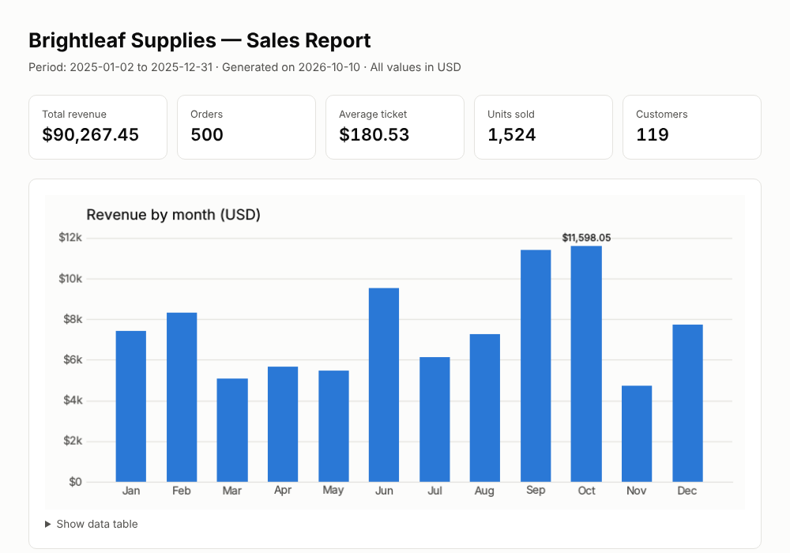

# Case Studies

**Data analysis and automation solutions, built end to end.**
Each case study takes a common business problem and solves it with working code,
automated tests and a ready-to-share result. All scenarios and data are fictitious.

**🌐 Browse the case studies online: [webert-dev-labs.github.io/case-studies](https://webert-dev-labs.github.io/case-studies/)**

---

## Case studies

<table>
  <tr>
    <td width="45%" valign="top">
      <a href="sales-report/">
        
      </a>
    </td>
    <td valign="top">
      <h3><a href="sales-report/">Automated Sales Report</a></h3>
      <p><strong>Problem:</strong> monthly sales reports built by hand in spreadsheets are slow,
      error-prone and inconsistent.</p>
      <p><strong>Solution:</strong> one command turns a sales file into a self-contained HTML report
      with KPIs, charts and data tables.</p>
      <p><strong>Result:</strong> the report is rebuilt in about a second, with identical numbers
      for identical input.</p>
      <p><code>Python</code> <code>pandas</code> <code>Matplotlib</code> <code>pytest</code></p>
    </td>
  </tr>
</table>

More case studies are on the way.

---

## What every case study includes

| Element | What you get |
|---|---|
| **Business framing** | Problem, solution and measurable result, in plain language |
| **Working code** | Runs locally in a few commands, with pinned dependencies |
| **Automated tests** | Core logic covered by tests that run before every change |
| **Sample output** | Screenshots or reports you can look at without running anything |

## Data and privacy

- All companies, people, products and figures are **fictitious** and generated by code
  with a fixed random seed, so every result can be reproduced.
- The code does not call external services or collect any data.
- A pre-commit hook in [`.githooks/`](.githooks/) blocks sensitive files and content from
  ever being committed. See [`PRINCIPLES.md`](PRINCIPLES.md).

## Run a case study

Requires Python 3.11+. From the repository root:

```bash
python -m venv .venv
source .venv/bin/activate              # Windows: .venv\Scripts\activate
pip install -r sales-report/requirements.txt
PYTHONPATH=sales-report/src python -m sales_report report
```

Each case study's README has the full instructions.

## Website

The site in [`docs/`](docs/) is generated from [`cases.json`](cases.json), the single list of
case studies, by a dependency-free script:

```bash
python tools/build_site.py      # rebuild docs/index.html
cd tools && pytest              # validate data, links and output
```

---

© 2026 webert-dev-labs. All rights reserved.
The code in this repository is shared for demonstration purposes only.
