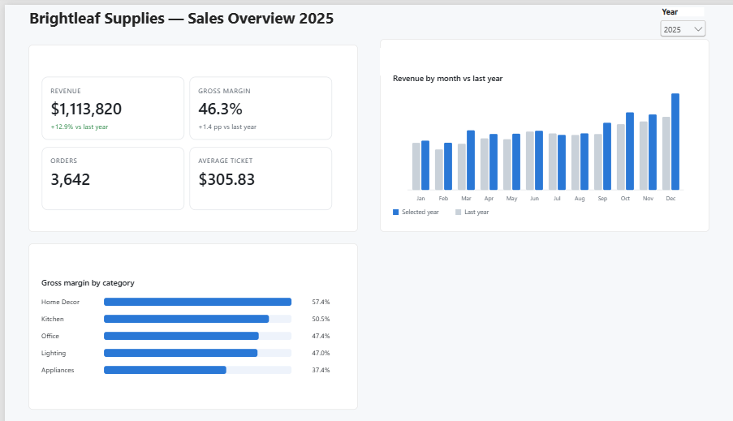
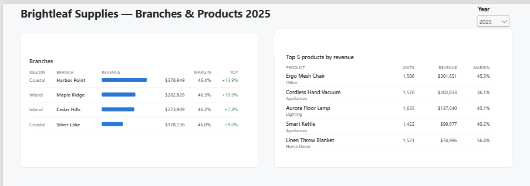
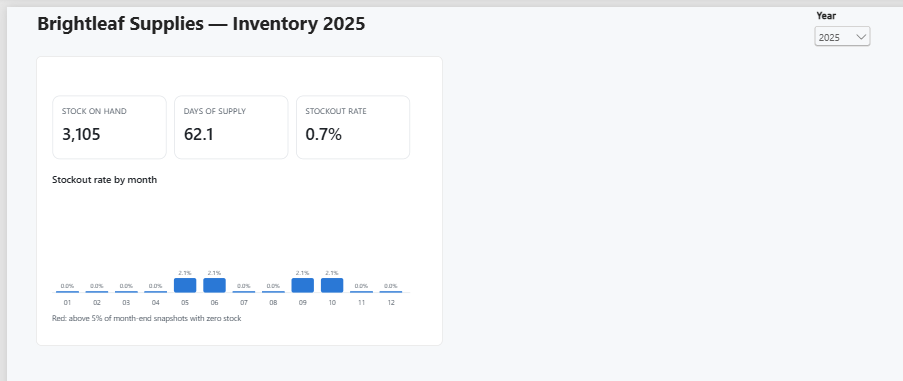
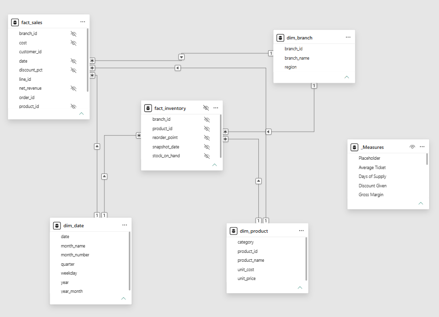

# Sales & Inventory Dashboard — Brightleaf Supplies

Power BI dashboard for **Brightleaf Supplies**, a fictitious home-and-office goods retailer
with four branches. It answers three questions in one place: how sales are growing, where
the margin comes from, and whether stock is under control. All data is invented and
generated by code.



| Branches & products | Inventory |
|---|---|
|  |  |

<details>
<summary>Data model (star schema)</summary>



</details>

## Problem

Sales, margin and stock usually live in separate spreadsheets. Managers cannot see in one
view whether revenue growth is coming with healthy margins, which branch or category drives
the result, or where products are running out.

## Solution

A star-schema model in Power BI with three report pages, drawn with SVG measures in native
visuals (no custom visuals):

1. **Overview** — revenue, margin, orders and average ticket, with year-over-year comparison.
2. **Branch & product drill-down** — region → branch → category → product, with revenue and
   margin at every level.
3. **Inventory** — stock on hand, days of supply and stockout rate over time.

The model, every DAX measure and the build steps are documented as text, and every measure
has a Python twin that produces the exact numbers the report must show.

## Result (sample data, 2025 vs 2024)

| Indicator | 2024 | 2025 |
|---|---|---|
| Revenue | $986,180 | $1,113,820 (**+12.9%**) |
| Gross margin | 44.8% | **46.3%** |
| Average ticket | $287.26 | $305.83 |
| Stockout rate | 5.9% | **0.7%** |

Full figures, by branch and category: [docs/expected-results.md](docs/expected-results.md).

## What is in this folder

| Path | Content |
|---|---|
| `powerbi/MODEL.md` | Tables, grain, relationships and data types |
| `powerbi/MEASURES.dax` | All DAX measures with format strings |
| `powerbi/SVG-MEASURES.dax` | Measures that draw each page as an SVG image for native visuals |
| `powerbi/BUILD-GUIDE.md` | Step-by-step build in Power BI Desktop |
| `powerbi/MCP-AGENT-PROMPT.md` | Prompt for an AI agent to build the model through the Power BI Modeling MCP server |
| `docs/expected-results.md` | Numbers the report must match |
| `src/sales_dashboard/` | Data generator and reference measures (Python) |
| `tests/` | Automated tests for the data and the measures |

Sample data (five CSV tables) lives in `examples/sales-dashboard/`.

## How to run

Requires Python 3.11+. From the repository root:

```bash
python -m venv .venv
source .venv/bin/activate            # Windows: .venv\Scripts\activate
pip install -r sales-dashboard/requirements.txt

# Regenerate the CSV tables and the expected results
PYTHONPATH=sales-dashboard/src python -m sales_dashboard generate
PYTHONPATH=sales-dashboard/src python -m sales_dashboard expected

# Run the tests
cd sales-dashboard && pytest
```

Then build the report following [powerbi/BUILD-GUIDE.md](powerbi/BUILD-GUIDE.md).

## Technologies

Power BI (Power Query, star schema, DAX, time intelligence, SVG measures) · Python · pandas · NumPy · pytest

## Notes

No `.pbix` file is published: a `.pbix` can carry hidden data and metadata, so the model is
documented as text instead. All companies, branches, products and figures are fictitious.
