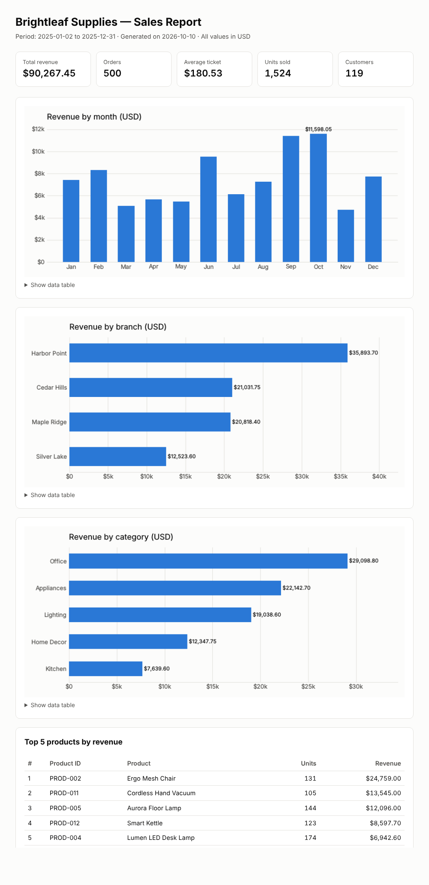

# Sales Report — Brightleaf Supplies

Automated sales report for **Brightleaf Supplies**, a fictitious home-and-office
goods store with four branches. All data is invented and generated by code.

**At a glance (sample year):** $90,267.45 revenue · 500 orders · $180.53 average ticket ·
4 branches compared · top 5 products ranked — rebuilt with one command.



## Problem

Small retailers often keep sales in spreadsheets and build their monthly report
by hand: copying numbers, recalculating totals and redrawing charts. This is
slow, error-prone and hard to repeat the same way every month.

## Solution

A small Python tool that turns a sales CSV into a ready-to-share report with
one command:

1. **Generate** a realistic, reproducible fictitious dataset (fixed random seed).
2. **Compute** the key indicators: total revenue, orders, average ticket,
   units sold, customers, revenue by month, branch and category, and top products.
3. **Publish** a single self-contained HTML file with KPI cards, charts and
   data tables. It needs no internet connection and no external resources.

## Result

- The full report is rebuilt in about a second from any CSV with the same columns.
- Identical input always produces identical numbers, so the report can be trusted and audited.
- 17 automated tests cover data generation, metrics, the HTML output and the CLI.

## How to run

Requires Python 3.11+. From the repository root:

```bash
python -m venv .venv
source .venv/bin/activate            # Windows: .venv\Scripts\activate
pip install -r sales-report/requirements.txt

# 1. (Optional) regenerate the fictitious sample data
PYTHONPATH=sales-report/src python -m sales_report generate

# 2. Build the report
PYTHONPATH=sales-report/src python -m sales_report report
# -> output/sales-report/report.html

# Run the tests
cd sales-report && pytest
```

Options:

| Command | Option | Default |
|---|---|---|
| `generate` | `--orders`, `--seed`, `--out` | `500`, `42`, `examples/sales-report/sales_sample.csv` |
| `report` | `--data`, `--out` | `examples/sales-report/sales_sample.csv`, `output/sales-report/report.html` |

On Windows PowerShell, set the path with `$env:PYTHONPATH = "sales-report/src"`.

## Input format

| Column | Example |
|---|---|
| `order_id` | `ORD-00001` |
| `order_date` | `2025-01-02` (ISO 8601) |
| `branch` | `Harbor Point` |
| `customer_id` | `CUST-0047` |
| `product_id` | `PROD-003` |
| `product_name` | `Graphite Notebook Set` |
| `category` | `Office` |
| `quantity` | `1` |
| `unit_price` | `12.50` (USD) |
| `total` | `12.50` (USD) |

## Project structure

```
sales-report/
├── src/sales_report/
│   ├── generate_data.py   # fictitious dataset with a fixed seed
│   ├── metrics.py         # pure KPI functions
│   ├── report.py          # charts + self-contained HTML
│   └── __main__.py        # command-line interface
├── tests/                 # pytest suite
└── docs/public/           # README images
```

## Technologies

Python 3 · pandas · NumPy · Matplotlib · pytest

## Notes

All companies, branches, products and customers are fictitious.
Any resemblance to real businesses is coincidental.

---

[← All case studies](../README.md)

© 2026 webert-dev-labs. All rights reserved. Shared for demonstration purposes only.
